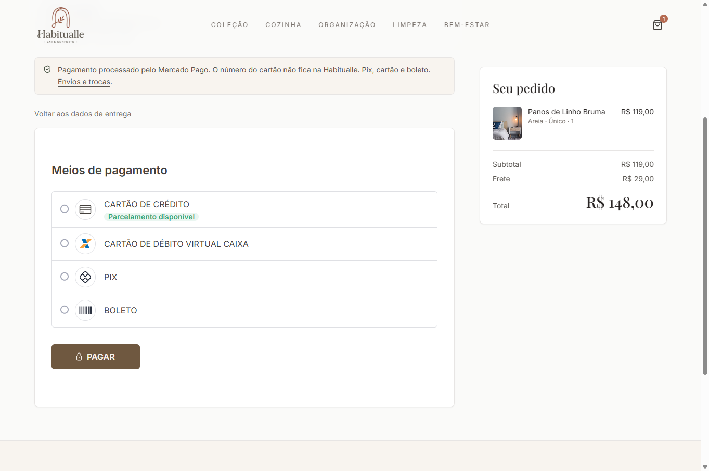

# Habitualle

Loja de peças para casa: cozinha, organização, limpeza e descanso.

No ar em [habitualle.vercel.app](https://habitualle.vercel.app).


O cliente escolhe na vitrine, fecha o pedido e paga pelo Mercado Pago sem sair da loja (cartão, Pix ou boleto). Depois acompanha a entrega pelo número do pedido. A equipe tem um painel separado para cadastrar produto, subir foto, mexer no estoque e atualizar o envio.



## Como o pedido é tratado

O preço cobrado sai do banco, não do que o navegador envia. Frete grátis a partir de R$ 299; abaixo disso, R$ 29.

Cada tentativa de pagamento tem uma chave própria. Se o cliente clica duas vezes, ou a conexão cai e ele tenta de novo, o banco devolve o mesmo pedido e o Mercado Pago recebe a mesma chave. Não sai cobrança em dobro.

O estoque baixa dentro da mesma transação que cria o pedido. Com uma unidade e duas compras ao mesmo tempo, só uma passa. Valor, frete e quantidade não mudam depois que o pedido existe.

O aviso de pagamento do Mercado Pago só é aceito com assinatura válida, e o status é sempre conferido de novo na API antes de mudar o pedido.

Para rastrear, o cliente informa o número HB e o e-mail ou o CPF da compra.

## Stack

Next.js 14 (App Router), React, TypeScript, Tailwind, Supabase (Postgres e Storage) e Mercado Pago (API de Orders e Payment Brick).

## Rodando local

```bash
npm install
cp .env.example .env.local
npm run dev
```

Preencha o `.env.local` com as chaves do Supabase e do Mercado Pago e com o acesso do painel. Rode os arquivos de `supabase/migrations` em ordem no SQL Editor do projeto.

```bash
npm test
```
